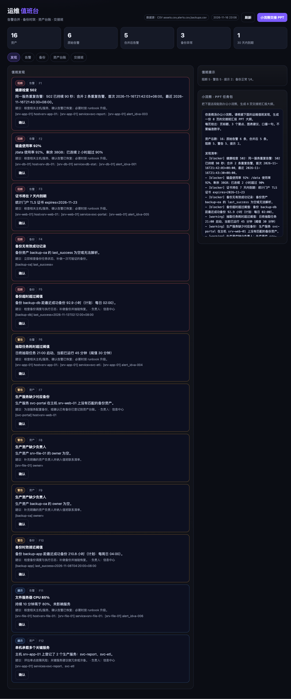

# 运维值班台（Ops Center）

给信息中心值班用的小工具：把监控告警、备份结果、资产台账三份导出数据，变成“今天必须处理什么”和一份交接班。

当前版本：`v0.1.1`（交接补丁） · [Gitee](https://gitee.com/cpufreestyle/ops-center) · [GitHub](https://github.com/cpufreestyle/ops-center)



## 能做什么

- 告警合并：按 `host + service + title` 去重，保留次数、首次/最近时间、最高级别。
- 备份时效：按日备/周备不同阈值判断；无成功记录、超时直接阻断。
- 资产台账：证书/授权到期、生产资产无负责人、生产服务无备份、单机多关键服务。
- 交接班：总体、必须处理、近期变更、待观察、交接备注；可导出 Markdown。
- Kindle 看板：`/kindle` 白底黑字、无 JS、每 5 分钟刷新。
- 小浣熊：把值班发现整理成 8 页交接班 PPT 大纲。

## 快速开始

```bash
python3 ops_center.py export-demo   # 生成 CSV 模板
python3 ops_center.py check         # 检查表头和格式
python3 ops_center.py report        # 打印交接班
python3 ops_center.py serve         # http://127.0.0.1:8890
```

局域网访问（Kindle 看板需要）加 `--host 0.0.0.0`：

```bash
python3 ops_center.py serve --host 0.0.0.0
```

把监控/备份/资产系统导出的 CSV 放进 `data/inbox/`，刷新页面或重新运行 `report` 即可。

## Kindle

Kindle 和 Mac 连同一个 Wi-Fi，浏览器打开 `http://<Mac-IP>:8890/kindle`。

服务必须监听 `0.0.0.0`（默认 `127.0.0.1` 只对本机可见）：

```bash
python3 ops_center.py serve --host 0.0.0.0
```

详见 [kindle/README.md](kindle/README.md)。

## 小浣熊

`docs/xhx/` 保留了开发时给小浣熊的 prompt 和输出：检查规则、8 页 PPT 大纲、300 字简介与 4 分钟路演脚本。

## 数据安全

- 演示数据全部是合成的；不包含任何真实内网资产。
- 真实导出放仓库外：`OPS_DATA_DIR="$HOME/ops-private/inbox" python3 ops_center.py report`。
- `data/inbox/*.csv`、`data/private/`、审计日志已在 `.gitignore`。

## 测试

```bash
python3 -m unittest tests.test_ops_center -v
```

## 发布

- Gitee 仓库：https://gitee.com/cpufreestyle/ops-center
- Gitee Releases：https://gitee.com/cpufreestyle/ops-center/releases
- GitHub 仓库：https://github.com/cpufreestyle/ops-center
- GitHub Release：https://github.com/cpufreestyle/ops-center/releases/tag/v0.1.1

## 文档

- [HANDOFF.md](HANDOFF.md)：项目交接、运行、数据契约、验收、限制与下一步
- [OPS_CENTER.md](OPS_CENTER.md)：使用说明和每天 5 分钟流程
- [data/inbox/README.md](data/inbox/README.md)：CSV 字段
- [docs/商业化方案.md](docs/商业化方案.md)：客户、定价、90 天试点
